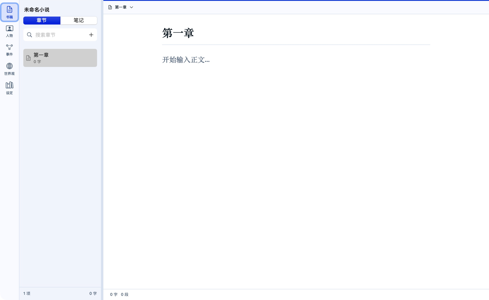

# Novel Engine

**A native writing workspace for long-form fiction.**

[简体中文](README.zh-CN.md) · [Documentation](docs/README.md) · [Changelog](CHANGELOG.md) · [Contributing](CONTRIBUTING.md)

[](https://github.com/Diamond-Fountain-Works/NovelEngine/actions/workflows/ci.yml)


[](LICENSE)

Novel Engine brings chapters, notes and manuscript editing into a configurable native macOS workspace. Place a reference editor beside or above your draft, and save your work as readable local files.

<picture>
  <source media="(prefers-color-scheme: dark)" srcset="docs/assets/workspace-dark.png">
  
</picture>

## Features

- **Reference library.** Switch between manuscripts, characters, events, worldbuilding and settings. Keep main cards and subdocuments, track canon status, and link related documents by stable ID.
- **Manuscripts and notes.** Create chapters and notes, edit synopses, search titles, reorder documents, and see character and paragraph counts.
- **Paired editors.** Keep the library fixed and place an auxiliary editor left, right, above or below the main editor. Select each editor's document independently, resize the divider and undo layout changes separately from text edits.
- **Native text editing.** SwiftUI with an AppKit text editor, input-method composition, selection, copy and paste, and text undo and redo.
- **Readable local documents.** A `.novelengine` package contains JSON metadata and separate UTF-8 text files. Formats 1 and 2 preserve document IDs and original text; reference-library documents use Format 2.
- **Two appearances.** Diamond Fountain Works light and dark themes, typography controls, and a focus view that preserves the workspace layout.

## Getting started

Requirements: macOS 13 or later and a Swift 6 toolchain. Development and UI checks currently run on Apple Silicon.

```sh
git clone https://github.com/Diamond-Fountain-Works/NovelEngine.git
cd NovelEngine
make run
```

The command builds and opens `build/Novel Engine.app`. To work in Xcode, open [`apps/apple/macOS/Package.swift`](apps/apple/macOS/Package.swift) and choose the `NovelEngine` product.

The native interface currently uses Simplified Chinese. v0.0.1 is a macOS source release; additional platform clients and cross-device synchronization are tracked in the [roadmap](docs/roadmap/PHASES.md).

## Workspace controls

| Action | Control |
| --- | --- |
| Create or reposition the auxiliary editor | Four direction buttons in the window toolbar |
| Change an editor's document | Document selector in that editor's header |
| Close the auxiliary editor | Close button in its header |
| Document information / synopsis | Information button in the window toolbar |
| Undo a layout change / restore default layout | Layout menu in the window toolbar |
| New chapter / note | ⇧⌘N / ⌥⌘N |
| Save / settings | ⌘S / ⌘, |

Moving or closing the auxiliary editor changes the view, not the manuscript files. Direction buttons reposition the same editor.

## Development

```sh
make build   # Build the macOS development app
make test    # Domain, layout, AppKit and document-package tests
make check   # Documentation, module boundaries and publication checks
make qa      # Build, tests and checks
```

| Directory | Responsibility |
| --- | --- |
| `apps/apple/macOS` | App scene, document adapter and bundle configuration |
| `packages/novel-core-swift` | Domain models, editing operations, file codec and workspace geometry |
| `packages/novel-ui-apple` | SwiftUI views, design tokens and AppKit adapters |
| `protocol` | Platform-neutral document-format specification |
| `docs` | Product, architecture, design, development and QA records |
| `script` / `scripts` | Build entry point and repository checks |

See the [reference-library guide](docs/product/REFERENCE_LIBRARY.md), [architecture](docs/architecture/ARCHITECTURE.md), [file format](protocol/PROJECT_FORMAT.md) and [QA record](docs/qa/NATIVE_QA.md) for implementation details and tested scope.

## License

[MIT](LICENSE) · © 2026 [Diamond Fountain Works](https://github.com/Diamond-Fountain-Works).
Bundled fonts and reference-preview icons retain the licenses listed in [Third-party notices](THIRD_PARTY_NOTICES.md).
