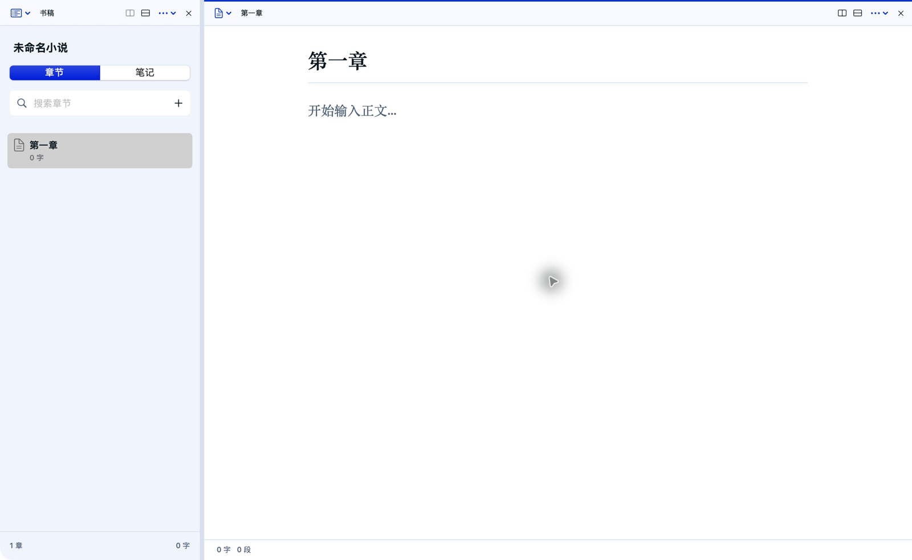

# Novel Engine

**面向长篇小说的原生写作工作台。**

[English](README.md) · [文档](docs/README.md) · [更新记录](CHANGELOG.md) · [参与开发](CONTRIBUTING.md)

[](https://github.com/Diamond-Fountain-Works/NovelEngine/actions/workflows/ci.yml)


[](LICENSE)

Novel Engine 将章节、笔记和正文编辑放进可调整的 macOS 原生工作区。按需要拆分区域，在正文旁查看笔记，作品保存在本地可读文件中。

<picture>
  <source media="(prefers-color-scheme: dark)" srcset="docs/assets/workspace-dark.png">
  
</picture>

## 功能

- **章节与笔记。** 创建章节和笔记，编辑摘要，搜索标题，调整顺序，查看字符和段落统计。
- **区域式工作区。** 直接向上下左右拆分；每个区域可切换为书稿、正文或章节信息。相邻区域可以合并，布局撤销与正文撤销独立。
- **原生文本编辑。** SwiftUI 界面与 AppKit 文本编辑器，支持输入法组合输入、选择、复制粘贴、撤销和重做。
- **本地作品文件。** `.novelengine` 文件包包含 JSON 元数据和独立的 UTF-8 正文。格式 1 保留文档 ID 与原文。
- **双主题与排版。** Diamond Fountain Works 日间 / 夜间外观、字体和字号设置，以及保留原有布局的专注模式。

## 开始使用

需要 macOS 13 或更新版本，以及 Swift 6 工具链。当前开发与界面检查使用 Apple Silicon Mac。

```sh
git clone https://github.com/Diamond-Fountain-Works/NovelEngine.git
cd NovelEngine
make run
```

命令会构建并打开 `build/Novel Engine.app`。也可用 Xcode 打开 [`apps/apple/macOS/Package.swift`](apps/apple/macOS/Package.swift)，选择 `NovelEngine` 产品。

原生界面当前使用简体中文。v0.0.1 发布 macOS 源码；其他平台客户端与跨设备同步见[路线图](docs/roadmap/PHASES.md)。

## 工作区操作

| 操作 | 入口 |
| --- | --- |
| 拆分当前区域 | 窗口右上角四个方向按钮 |
| 拆分指定区域 | 该区域直接向右 / 向下按钮，或标题右键菜单 |
| 切换区域内容 | 区域标题左侧的类型选择器 |
| 合并相邻区域 | 右键区域标题或公共分隔线；源区域向所选方向扩展 |
| 撤销布局 / 恢复默认布局 | 窗口工具栏的布局菜单 |
| 新建章节 / 笔记 | ⇧⌘N / ⌥⌘N |
| 保存 / 设置 | ⌘S / ⌘, |

合并和关闭区域只改变视图，文稿仍然保留。v0.0.1 支持完整共边的矩形相邻区域合并。

## 开发

```sh
make build   # 构建 macOS 开发 App
make test    # 领域、布局、AppKit 与作品文件测试
make check   # 文档、模块边界与公开发布检查
make qa      # 构建、测试与检查
```

| 目录 | 职责 |
| --- | --- |
| `apps/apple/macOS` | App 入口、系统文档适配与 Bundle 配置 |
| `packages/novel-core-swift` | 领域、编辑用例、作品编解码与布局几何 |
| `packages/novel-ui-apple` | SwiftUI、设计 Token 与 AppKit 适配 |
| `protocol` | 平台无关作品格式 |
| `docs` | 产品、架构、设计、开发与 QA |
| `script` / `scripts` | 构建入口与工程检查 |

实现细节及验证范围见[架构](docs/architecture/ARCHITECTURE.md)、[作品格式](protocol/PROJECT_FORMAT.md)和[原生 QA](docs/qa/NATIVE_QA.md)。

## 许可证

[MIT](LICENSE) · © 2026 [Diamond Fountain Works](https://github.com/Diamond-Fountain-Works)。
字体和历史预览图标保留各自许可证，见[第三方声明](THIRD_PARTY_NOTICES.md)。
