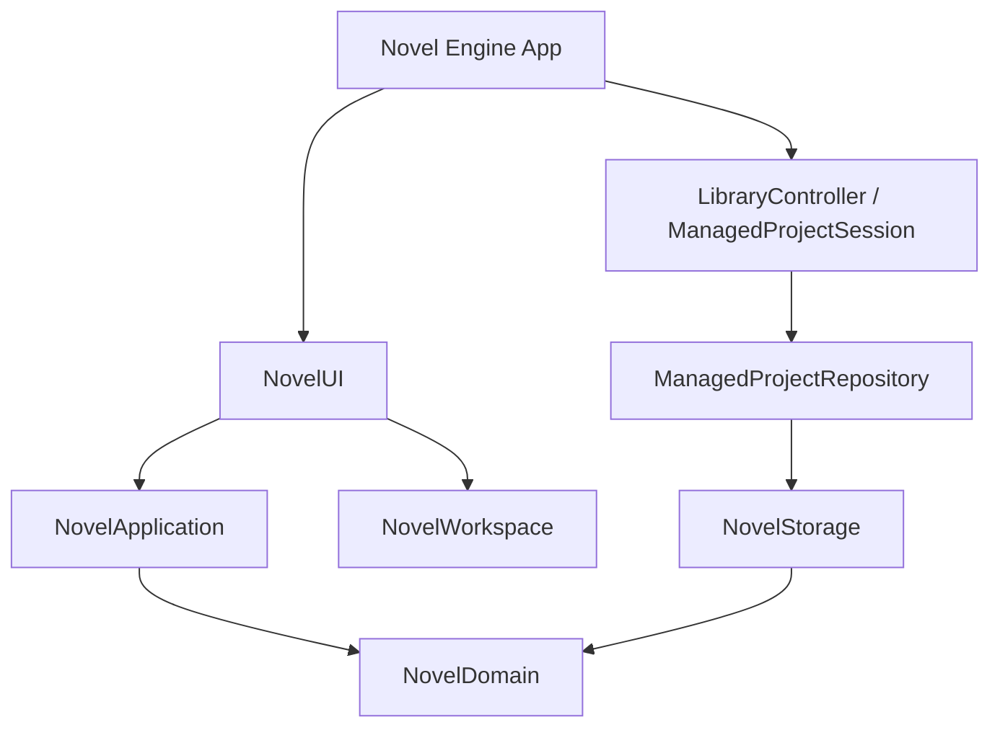

# Novel Engine 架构

日期：2026-11-17。当前实现：macOS 原生托管作品库 App；HTML 保留作历史设计参考。

## 源码边界

```text
apps/apple/macOS/                    App 入口、作品库、自动保存、文件面板和 Bundle 配置
packages/novel-core-swift/
  Sources/NovelDomain/               作品、章节、笔记、字数等值模型
  Sources/NovelApplication/          显式编辑、创建和排序用例
  Sources/NovelStorage/              版本化作品编解码、快照、原图和事务存储
  Sources/NovelWorkspace/            与正文独立的布局树和布局历史
  Tests/NovelCoreTests/              领域、格式与分栏模型测试
packages/novel-ui-apple/
  Sources/NovelUI/DesignSystem/       DFW 色彩、品牌字体和外观设置
  Sources/NovelUI/Writing/            侧栏、正文分栏和字段绑定
  Sources/NovelUI/Workspace/          会话、分栏、菜单与命令
  Sources/NovelUI/Library/            模块导航、层级目录与资料属性
  Sources/NovelUI/Platform/macOS/     NSTextView 输入与原生分隔条适配
  Sources/NovelUI/Resources/          DFW 字体、星形与许可证
  Tests/NovelUITests/                原生输入、焦点、菜单与会话检查
protocol/                           平台无关作品格式
script/build_and_run.sh              单一 macOS 构建 / 运行入口
scripts/                            工程检查工具
```

尚未实现的平台和服务不创建空工程。版本不复制成 0.0.1、0.0.2 源码目录。构建产物统一在 `build/`。

## 依赖方向与 OOP



- `NovelProject` / `WritingDocument`：值模型，稳定 UUID；UI 不另存第二份正文。
- `ReferenceDetails`：定案状态、标识、标签、引用，以及事件参与者 / 前置 / 相对时间。资料子文档通过 parentID 同类型关联。
- `ProjectLibrary`：生成保留祖先的目录搜索结果与反向引用，不重排事件代码。
- `ProjectEditingService`：显式编辑用例，注入时钟，不改写作者输入。
- `ProjectPackageCodec`：格式边界，不依赖 SwiftUI、AppKit 或数据库。
- `ManagedProjectRepository`：actor 串行文件操作，跨进程锁、完整快照、原子 head 发布、修订比较、原图和导入 / 导出。
- `LibraryController`：共享作品目录与会话，同一作品在一个进程中只持有一份可编辑模型。
- `ManagedProjectSession`：编辑状态、350ms 合并保存、串行最新值写入与失败草稿保留；正常退出等待保存。
- `NovelFileDocument`：保留历史 FileWrapper 格式验收，当前运行入口已切换为 WindowGroup 和作品库。
- `WorkspaceSession`：每个作品窗口一个 MainActor 对象，管理选中分栏、搜索、布局撤销和本机偏好。
- `EditorWorkspaceLayout`：主编辑区与一个可移动辅助区。资料导航固定在布局外；文档信息使用原生 Sheet。旧 `WorkspaceLayout` 只供历史布局读取与兼容测试。
- `AreaFocusRequest`：记录程序操作完成后需要获取键盘焦点的区域；手动点击切换与程序请求分开处理，避免抢占标题输入。
- `MacTextEditor.Coordinator`：只处理输入、焦点与 Binding 回写。AppKit 对象不进入领域层。
- `EditorWorkspaceSnapshot`：保存主区、辅助区、方向、比例与活动 ID；切换方向保留两区 ID 和文档引用。`WorkspaceGeometry` 保留历史布局解码和几何计算。
- `WorkspaceFrames`：将布局树换算为包含真实分隔条厚度的物理矩形。UI 按稳定 pane ID 平铺呈现，不随父分支变化重建整个编辑器层级。
- `AreaDividerView`：提供原生拖动、方向键调整和双击均分；不再重复提供分栏入口。

OOP 用于明确所有权和封装；不把所有模型改成 class，也不添加没有实际职责的 Manager 或空仓储接口。以后接入数据库时，在应用层边界引入真正需要的仓储协议。

## 正文、保存与布局

`WindowGroup` 打开 LibraryRootView。作品库进入作品主页或原生编辑器；两者 Binding 到同一个 ManagedProjectSession.project，不维护第二套正文。模型变化经串行自动保存持久化，保存失败保留编辑并显示具体错误，导出可包含未保存的草稿。

默认根目录由系统 documentDirectory 定位，追加 `Novel Engine/作品`；内部目录使用稳定 project UUID，改书名不改变位置。每部作品的 head.json 指向已验证快照，revisions 仅保留当前与上一份。未发布的半成品不能成为当前作品。保存先验证现有 revision 和内容摘要，跨进程使用文件锁；外部改变时拒绝覆盖。

App 读取作品格式 1、2、3；没有作品级资料时仍按原规则写 1 或 2，作品资料 / 封面写 3。简介、作者和正文保持原始 Unicode 字节。封面按 UUID 存放原始文件，ImageIO 缩略图只用于显示。导出 `.ne` 只含 project.json、documents 和必要 assets，导入同时接受旧扩展名且不修改源文件。

QA 构建使用独立 Bundle ID 和显式 NovelEngineQARoot。配置缺失、相对路径或指向正式作品库时拒绝启动；测试不回退到正式文稿目录。

左侧资料导航固定在编辑器布局外。`LibraryBrowserState` 持有当前模块、章节 / 笔记筛选和临时搜索。点击目录项在活动编辑区打开；每个编辑区的文档选择器只操作自己的 pane ID。两个编辑区引用同一个 project，不另存作者正文。

窗口顶部四向按钮创建辅助区，之后只移动同一个辅助区。主区没有关闭按钮；关闭辅助区后主区铺满。信息与摘要在独立原生 Sheet 中编辑，不占用辅助区。专注模式暂时隐藏导航和其他编辑区；退出后恢复原布局。布局撤销只恢复视图与文档选择，不回滚作者原文。

本机偏好使用 `workspace.editors.<projectID>` 与 `library.browser.<projectID>`。新 key 缺失时，读取旧 `workspace.areas` 或 `workspace` 快照：保留第一个正文编辑器与当前活动的另一个编辑器；仅收拢多余视图，所有作品文档仍在原文件中。旧 key 保持原值。旧资料模块选择迁入固定导航，搜索词不写入偏好。非法快照只放弃布局，不替换作品。

`NativeSplitNode` 仍按稳定 pane ID 平铺呈现 NSTextView；改变左右 / 上下位置不重建其文档模型。显示时根据实际窗口尺寸限制两区最小尺寸，缩窗不覆盖保存比例。恢复旧布局与比例有独立 XCTest。

## 当前状态与后续边界

- App 0.0.1 Build 18，开发 Bundle ID `com.diamondfountain.novelengine.dev`。Build 4 为统一区域与焦点排查的中间版本。
- 作品格式读取 1、2、3。没有数据库 Schema 或同步协议版本；不会用 App 版本冒充它们。
- 当前使用本地文件作品库，未接入数据库。早期文档型入口见 [ADR 0001](decisions/0001-native-document-foundation.md)。
- SQLite、Outbox、签名日志、服务器、账号和跨端同步均未实施。后续合同必须保留并发正文双方版本，不能整篇 LWW 丢字。
- Apple UI 的 macOS 适配编译隔离。共享核心的平台声明为 macOS 13 / iOS 16，但当前只实际构建测试 macOS。
- Windows / Android 应以统一作品格式和测试向量接入，不直接使用 NSTextView 或 FileDocument 作为公共协议。

## 项目参考与采用范围

- 本机 Together main `fb3d87e471fe1c7cf635a2e2410313db4ab89835` 的 `apps/apple/macOS/Package.swift` 和 `packages/together-core-swift/Package.swift`：平台入口与共享包分开。没有复制其数据库、身份、配对或网络实现。
- [VS Code Source Code Organization](https://github.com/microsoft/vscode/wiki/Source-Code-Organization)：低层公共能力、平台服务与工作区职责分层，模块通过明确 API 交互。这里采用依赖方向，不引入 Electron。
- [Swift Documentation Index](https://github.com/swiftlang/swift/blob/main/docs/README.md)：文档索引按构建、贡献、测试和参考分类。这里据此把产品、架构、设计、开发、QA 和路线分开。
- OpenFic 仅参考写作工作区组织，日夜外观均采用 [DFW 设计规范](../design/DESIGN_SYSTEM.md)。

## 资料导航与属性输入

固定资料导航由 LibraryBrowserState 持有模块和书稿筛选，按作品保存；搜索词不持久化。编辑器选择或焦点变化不覆盖目录当前模块。

ReferenceSummaryBar 打开原生属性 Sheet，先撤销待处理的正文焦点请求。ReferenceDetailsEditor 管理字段焦点和标签输入；完成后仅提交实际变化。ProjectBindings 在值没有变化时不写 Document Binding，防止关闭属性窗口也触发已编辑状态。

NovelProject.validate 校验同类型父子、存在的引用、顶级参与人物与无环事件前置。编辑先在候选值完成校验，再一次提交；codec 读写再次验证。文档及资料字段的相等性按 UTF-8 字节比较，显式的 Unicode 编码变化不被吞掉。

## 自动保存和退出

编辑串号与已保存串号分开；写入期间的新编辑排在下一次保存，不并发覆写同一作品。Socket、网络与账号不参与此流程。状态只有待保存、保存中、已保存和真实失败。AppDelegate 正常退出等待所有会话及封面复制完成；失败时取消退出，保留草稿。异常退出只保证已提交快照，尚处于待保存状态的输入不作持久化承诺。

原图目前随作品保留，替换后的原图没有自动清理策略。修订快照不等于完整修订历史或跨设备备份。
