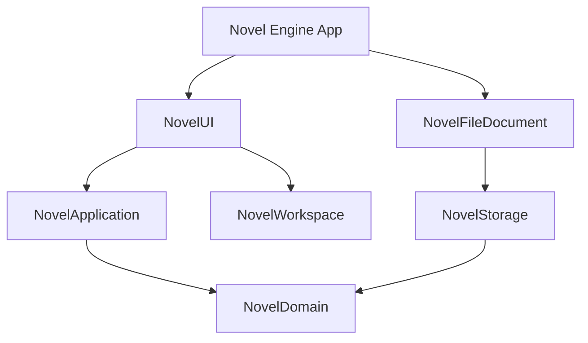

# Novel Engine 架构

日期：2026-11-17。当前实现：macOS 原生文档 App；HTML 保留作历史设计参考。

## 源码边界

```text
apps/apple/macOS/                    App 入口、系统文档适配、Bundle 配置
packages/novel-core-swift/
  Sources/NovelDomain/               作品、章节、笔记、字数等值模型
  Sources/NovelApplication/          显式编辑、创建和排序用例
  Sources/NovelStorage/              版本化文件包编解码
  Sources/NovelWorkspace/            与正文独立的布局树和布局历史
  Tests/NovelCoreTests/              领域、格式与分栏模型测试
packages/novel-ui-apple/
  Sources/NovelUI/DesignSystem/       DFW 色彩、品牌字体和外观设置
  Sources/NovelUI/Writing/            侧栏、正文分栏和字段绑定
  Sources/NovelUI/Workspace/          会话、递归分栏、菜单与命令
  Sources/NovelUI/Platform/macOS/     NSTextView 输入与原生分隔条适配
  Sources/NovelUI/Resources/          DFW 字体、星形与许可证
  Tests/NovelUITests/                原生输入、焦点、菜单与会话检查
protocol/                           平台无关作品格式
script/build_and_run.sh              单一 macOS 构建 / 运行入口
scripts/                            工程检查工具
```

尚未实现的平台和服务不创建空工程。版本不复制成 0.0.1、0.0.2 源码目录。构建产物统一在 `build/`。

## 依赖方向与 OOP



- `NovelProject` / `WritingDocument`：值模型，稳定 UUID；UI 不另存第二份正文。
- `ProjectEditingService`：显式编辑用例，注入时钟，不改写作者输入。
- `ProjectPackageCodec`：格式边界，不依赖 SwiftUI、AppKit 或数据库。
- `NovelFileDocument`：将目录型 FileWrapper 转为通用文件条目，交给 codec；NSDocument / DocumentGroup 处理系统保存流程。
- `WorkspaceSession`：每个作品窗口一个 MainActor 对象，管理选中分栏、搜索、布局撤销和本机偏好。
- `WorkspaceContent`：书稿、正文、章节信息三种区域内容。三者都进入同一 `WorkspaceLayout`，侧栏不再是布局树外的固定面板。
- `AreaFocusRequest`：记录程序操作完成后需要获取键盘焦点的区域；手动点击切换与程序请求分开处理，避免抢占标题输入。
- `MacTextEditor.Coordinator`：只处理输入、焦点与 Binding 回写。AppKit 对象不进入领域层。
- `WorkspaceGeometry`：计算规范化区域及完整共享边的相邻关系；跨分支合并重新切分剩余区域，保留 pane ID、文档 ID 和其他区域矩形。
- `WorkspaceFrames`：将布局树换算为包含真实分隔条厚度的物理矩形。UI 按稳定 pane ID 平铺呈现，不随父分支变化重建整个编辑器层级。
- `AreaDividerView`：提供鼠标位置、原生菜单派发、拖动和方向键输入；布局决策留在核心层。

OOP 用于明确所有权和封装；不把所有模型改成 class，也不添加没有实际职责的 Manager 或空仓储接口。以后接入数据库时，在应用层边界引入真正需要的仓储协议。

## 正文、保存与布局

`DocumentGroup` 持有 `NovelFileDocument`，NativeWorkspace 通过 Binding 编辑同一个 project。共享文档的多个分栏引用同一 document ID。每次输入由应用服务生成新的值状态；标记中的输入法文本暂不回写，不用 SwiftUI 更新覆盖组合输入。

文件包含 `project.json` 和独立 UTF-8 正文。当前格式版本 1，见 [格式合同](../../protocol/PROJECT_FORMAT.md)。原生保存及关闭行为交给系统文档机制。存储解码失败会抛出错误，不能用新作品静默替代。

布局树、选中区域和比例按作品 ID 写入开发 App 的 UserDefaults。局部控件传入所属 pane ID；正文获得 first responder 时即切换活动区域，不等待首次输入。书稿列表打开文档时，目标是最近活动的正文区，不把书稿区误当成正文。

Build 1–3 的布局记录从旧 key 只读迁移：旧 pane 默认为正文，原 ID 和文档引用保留，外加一个书稿区域。新版 key 单独保存区域布局；用户关闭书稿后，重启不会自动把它加回来。旧 key 不删除，作品格式仍为 1。

Join 的源组向相邻方向扩展，关闭一个目标视图，不能删除整个嵌套子树。只有两区域完整共边、结果可由布局树表达时才允许合并。分隔条上下不同位置分别确定相邻组。关闭分栏、合并、恢复单栏都不删除正文；布局撤销恢复原布局，不回滚正文。专注模式隐藏其他组而不替换布局树。布局快照引用不存在的文档时，只放弃布局偏好，作品内容不受影响。

## 当前状态与后续边界

- App 0.0.1 Build 6，开发 Bundle ID `com.diamondfountain.novelengine.dev`。Build 4 为统一区域与焦点排查的中间版本。
- 文件格式 1。没有数据库 Schema 或同步协议版本；不会用 App 版本冒充它们。
- 当前选择文件型原生 App，替代此前尚未实施的 SQLite 建议。选择依据见 [ADR 0001](decisions/0001-native-document-foundation.md)。
- SQLite、Outbox、签名日志、服务器、账号和跨端同步均未实施。后续合同必须保留并发正文双方版本，不能整篇 LWW 丢字。
- Apple UI 的 macOS 适配编译隔离。共享核心的平台声明为 macOS 13 / iOS 16，但当前只实际构建测试 macOS。
- Windows / Android 应以统一作品格式和测试向量接入，不直接使用 NSTextView 或 FileDocument 作为公共协议。

## 项目参考与采用范围

- 本机 Together main `fb3d87e471fe1c7cf635a2e2410313db4ab89835` 的 `apps/apple/macOS/Package.swift` 和 `packages/together-core-swift/Package.swift`：平台入口与共享包分开。没有复制其数据库、身份、配对或网络实现。
- [VS Code Source Code Organization](https://github.com/microsoft/vscode/wiki/Source-Code-Organization)：低层公共能力、平台服务与工作区职责分层，模块通过明确 API 交互。这里采用依赖方向，不引入 Electron。
- [Swift Documentation Index](https://github.com/swiftlang/swift/blob/main/docs/README.md)：文档索引按构建、贡献、测试和参考分类。这里据此把产品、架构、设计、开发、QA 和路线分开。
- OpenFic 仅参考写作工作区组织，日夜外观均采用 [DFW 设计规范](../design/DESIGN_SYSTEM.md)。
